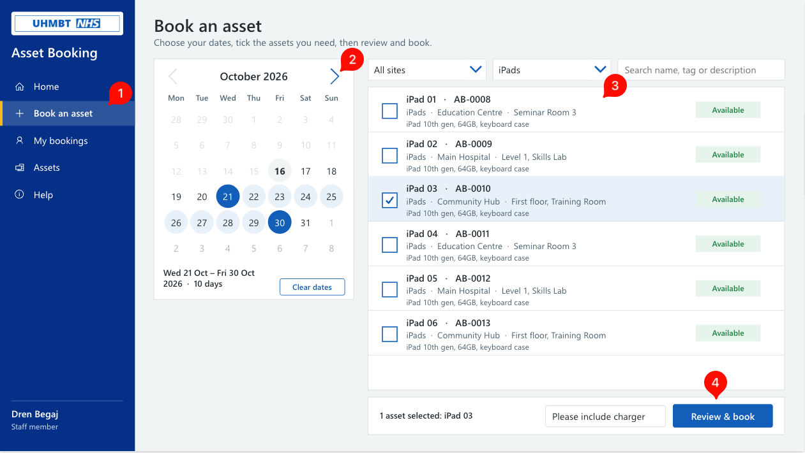
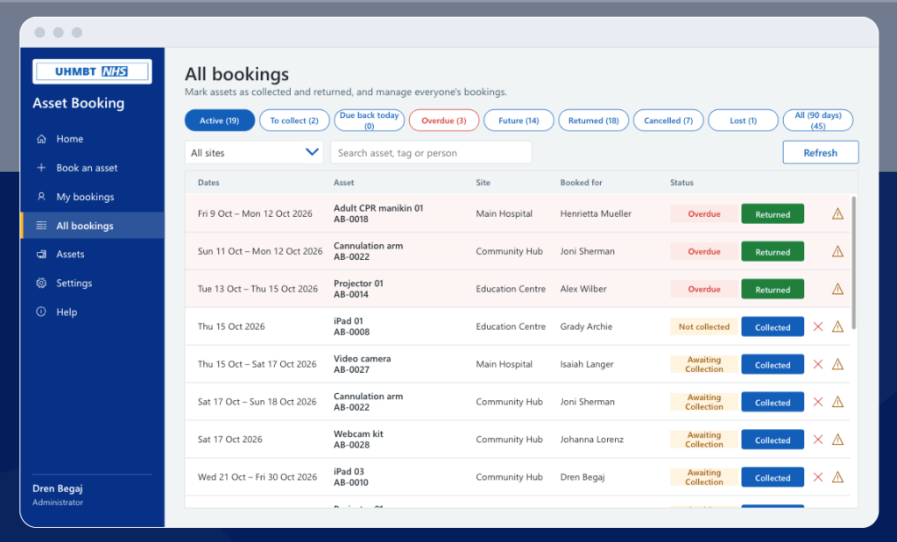

# Asset Booking for NHS teams

**Book, track and return shared equipment, built on the Microsoft 365 your trust already has.**

Asset Booking is a Power Apps app for any team that lends out shared kit: laptops, simulation
equipment, teaching aids, loan devices. Staff book what they need for a date range. Admins see
what's due out, due back and overdue, and the reminder emails go out on their own.

It was built by the I3 Digital Services Team at University Hospitals of Morecambe Bay NHS
Foundation Trust and is **available free to NHS organisations on request**.

| Book an asset |
|---|
|  | 

| All bookings (admin) | 
|---|
|  |

## What it does

- **Book several assets at once** for a date range, with live availability and a configurable buffer between bookings
- **Confirmation emails**, plus collection and return reminders, from a shared mailbox
- **Overdue tracking**, with a daily summary to the team
- **Lost or damaged kit logged** against the asset and the booking
- **Admin access through a security group**, so there's no app editing when people change
- **Automatic archiving** of old bookings, so the lists stay fast
- **Desktop and tablet layout**

## What you need

- Microsoft 365 with **SharePoint Online** and **Power Apps / Power Automate** (standard connectors only: SharePoint, Office 365 Outlook, Office 365 Users, Office 365 Groups, so **no premium licences**)
- A Power Platform environment you can import solutions into
- A SharePoint or Teams site, a security group for admins, and a shared mailbox

No patient data is stored. The lists hold assets, sites and staff bookings.

## How it's delivered

Two unmanaged Power Platform solutions:

1. **Asset Booking Setup**: run-once flows that create the SharePoint lists, settings and permissions, and optionally migrate data from an older booking app
2. **Asset Booking**: the app and six flows (confirmations, cancellations, reminders, lost-kit notices, archiving)

The setup guide takes about 30 minutes from import to a working app.

## Request access

The solution files are in a private repository. To get access:

1. You'll need a GitHub account.
2. **[Submit an access request](https://forms.cloud.microsoft/e/FBqkcKgg3k)**.
3. We check the request, normally within a few working days.
4. You receive a GitHub invitation to the private repository with **read** access to download the releases and setup guide.

> Submitting an access request will trigger an automated email to your mailbox. 
> Please reply to this email with your GitHub username only so we can process
> your request quicker.

## Terms

Provided free to NHS organisations for use within their own organisation, as is and without
warranty. Please don't redistribute the solution files outside your organisation; point
colleagues here instead. Each organisation is responsible for its own testing, DPIA and
deployment.

## Contact

I3 Digital Services Team, University Hospitals of Morecambe Bay NHS Foundation Trust.

Questions: open an issue in this repository.
